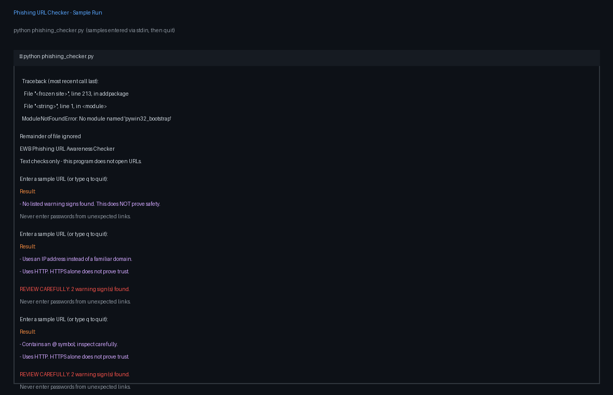
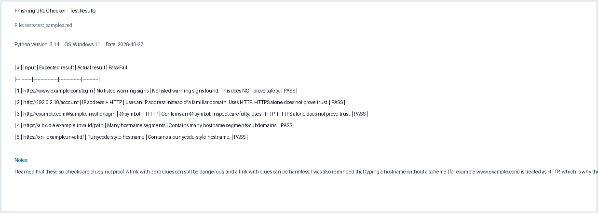

# EWB Phishing URL Awareness Checker

## Overview
Phishing is a trick that uses fake links or messages to try to make people share passwords, card numbers or OTPs. The fake link often looks almost like a real one. This tool is a small command-line program that reads a URL as text and points out a few visible warning signs so the reader can decide to review it carefully. It never opens, visits or scans the link, and it never sends anything anywhere.

## Features
- Detects an @ symbol in the URL
- Flags unusually long URLs (over 100 characters)
- Flags IP-address hostnames
- Flags many hostname segments (5 or more)
- Flags punycode-style hostnames (xn--)
- Flags the HTTP scheme
- Loops so you can check several URLs without restarting, with a quit command
- Handles malformed input clearly instead of crashing

## Requirements
Python 3.10 or later. No extra packages.

## How to Run
Windows:   python phishing_checker.py  
Mac/Linux: python3 phishing_checker.py

## Example Output
Type: http://192.0.2.10/account
Result:
- Uses an IP address instead of a familiar domain.
- Uses HTTP. HTTPS alone does not prove trust.
REVIEW CAREFULLY: 2 warning sign(s) found.

## Testing
| # | Input | Expected | Actual | Result |
|---|-------|----------|--------|--------|
| 1 | https://www.example.com/login | No warning signs | No listed warning signs found. This does NOT prove safety. | PASS |
| 2 | http://192.0.2.10/account | IP address + HTTP | Uses an IP address instead of a familiar domain. Uses HTTP. HTTPS alone does not prove trust. | PASS |
| 3 | http://example.com@sample.invalid/login | @ symbol + HTTP | Contains an @ symbol; inspect carefully. Uses HTTP. HTTPS alone does not prove trust. | PASS |
| 4 | https://a.b.c.d.e.example.invalid/path | Many hostname segments | Contains many hostname segments/subdomains. | PASS |
| 5 | https://xn--example.invalid/ | Punycode-style hostname | Contains a punycode-style hostname. | PASS |

Full test file: tests/test_samples.md

## Screenshots

## Improvements
1. Loop with quit - the program now keeps asking for URLs until you type q, so you can inspect several links in one run. I tested it by running five samples in one session and then quitting cleanly with q.
2. Safer input handling and a review summary - I wrapped the URL parsing in try/except so malformed input no longer crashes the program, and I added a REVIEW CAREFULLY summary when real warning signs are found. I re-ran all five tests after the change and they still passed.

## Limitations
This is an educational tool. It only reads URL text. It does not visit URLs, scan for malware, check reputation services or prove that a URL is safe. No warning signs found does NOT mean a URL is safe.

## Ethical Use
Use sample strings only. Do not collect credentials. Do not use this project to deceive anyone or to test websites without permission.

## Author
Firdous Jahan Begum, Cybersecurity Mini Project, EWB Courses
